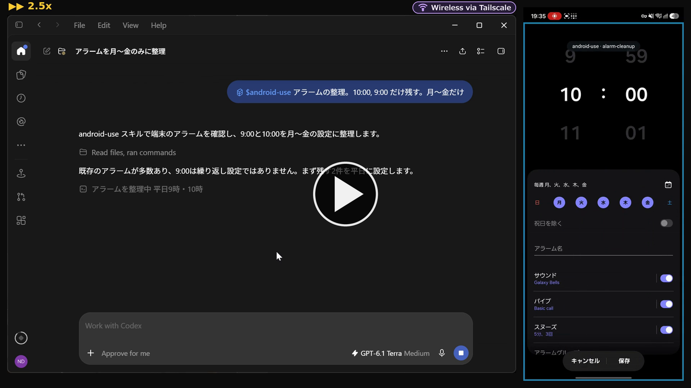
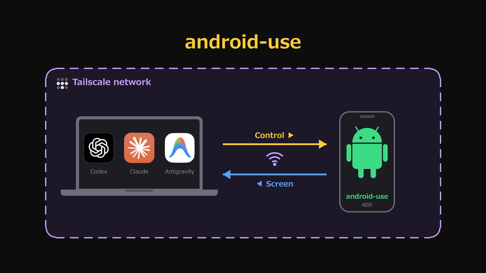

# android-use

Let AI agents see and operate a real Android phone — over Tailscale, no USB cable required.

android-use is a small Android app that exposes the phone's screen and input as an HTTP/JSON API, plus an [Agent Skill](skills/android-use/SKILL.md) that teaches coding agents (Codex, Claude Code, Antigravity, …) how to use it.

[](docs/assets/demo.mp4)

▶ [Watch the demo (56s)](docs/assets/demo.mp4) — Codex is asked to keep only the 9:00 and 10:00 alarms, weekdays only, and does it on a real phone over Tailscale (parts sped up 2.5–7x).

## How it works



- **On the phone**, the android-use app runs an embedded HTTP server (Ktor) and an Accessibility Service that:
  - captures screenshots and the UI tree,
  - injects taps, long-presses, swipes, system keys and text input,
  - lists and launches apps, and waits for UI elements to appear or disappear.
- **On the PC**, your agent calls the API through the bundled helper script `skills/android-use/scripts/android-use.sh`.
- **Between them**, the connection goes over Tailscale (wireless, works from anywhere in your tailnet) or USB via `adb forward`.

Every task runs inside an explicit **session**: while a session is active, an on-screen overlay shows that an agent is in control and the screen is kept awake. Idle sessions end automatically after 10 minutes.

## Requirements

- Android 13+ (API 33) phone. No root required.
- [Tailscale](https://tailscale.com/) on both the phone and the PC — or a USB cable and `adb`.
- `curl` on the PC (`jq` recommended).
- To build from source: JDK 21 and the Android SDK.

## Setup

### 1. Build and install the app

```bash
./gradlew assembleDebug
```

```bash
adb install app/build/outputs/apk/debug/app-debug.apk
```

### 2. Enable the Accessibility Service

Open **android-use** → **Open Accessibility Settings** → enable **android-use Automation**.

On Android 13+, sideloaded apps must first be allowed: **Settings → Apps → android-use → ⋮ → Allow restricted settings**.

### 3. Start the server

In the app, pick a **Network Interface** and tap **Start Server**:

| Mode | Binds to | Auth | Use when |
| --- | --- | --- | --- |
| **Tailscale** (recommended) | the phone's Tailscale IP | Bearer token | Wireless, from any device in your tailnet |
| Loopback only | `127.0.0.1` | none | USB with `adb forward tcp:8765 tcp:8765` |
| All interfaces | `0.0.0.0` | Bearer token | Tailscale and LAN |

The server listens on port `8765`. Outside loopback, a Bearer token is required; it is shown in the app (**Rotate Token** / **Copy curl Command**).

### 4. Connect from the PC

```bash
export ANDROID_USE_URL=http://<phone-tailscale-ip>:8765
export ANDROID_USE_TOKEN=<token from the app>
skills/android-use/scripts/android-use.sh health
```

`"accessibilityConnected": true` means you're ready.

### 5. Give the skill to your agent

Copy or symlink `skills/android-use` into your agent's skills directory, e.g. `.agents/skills/` for Codex (this repo already links it there) or `.claude/skills/` for Claude Code. Then just ask:

> $android-use Clean up my alarms — keep only 9:00 and 10:00, Monday to Friday.

## Helper script

```bash
S=skills/android-use/scripts/android-use.sh

$S session-start "my-task"         # required before observing or acting
$S tree                            # compact UI tree with tap coordinates
$S screenshot /tmp/screen.jpg
$S apps clock                      # find a package name
$S launch com.example.app
$S tap 540 1200
$S swipe 500 2000 500 600 pixel 500
$S type "hello" false true         # text, clearFirst, submit
$S key BACK
$S wait-text "Done" 5000
$S session-end
```

See [SKILL.md](skills/android-use/SKILL.md) for the full command list, the recommended agent workflow and error codes.

## HTTP API

All endpoints are under `/v1/`:

- **Session**: `GET /v1/session`, `POST /v1/session/start`, `POST /v1/session/end`
- **Device**: `GET /v1/health`, `GET /v1/device/info`, `POST /v1/device/wake`
- **Observe**: `GET /v1/screen/screenshot`, `GET /v1/screen/tree`, `GET /v1/screen/state`
- **Act**: `POST /v1/actions/{tap,long-press,swipe,key,type,clear,ime}`
- **Apps & waiting**: `GET /v1/apps`, `POST /v1/apps/launch`, `POST /v1/wait`

Design notes are in [docs/adr](docs/adr/README.md).

## Limitations

- Android does not let non-root apps bypass a PIN or biometric lock screen; unlock the phone yourself first.
- Screens protected with `FLAG_SECURE` (banking apps, DRM video) can't be captured.
- Android rate-limits Accessibility screenshots to roughly one every 0.3–1s.

## Development

```bash
./gradlew testDebugUnitTest
```

```bash
./gradlew lint
```
